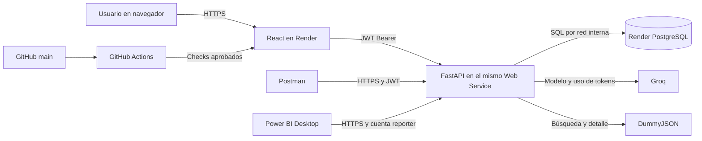
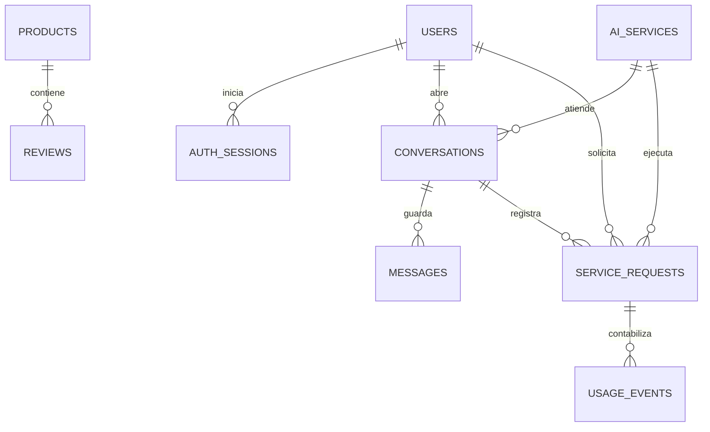

# Criterio · Propuesta técnica

## Objetivo y usuarios

Criterio ayuda a explorar opiniones de productos, identificar problemas recurrentes y comparar alternativas con evidencia identificable. El usuario consulta el catálogo, sus conversaciones y su saldo. El administrador gestiona cuentas, productos, reseñas, modelos, activación de servicios y cupos. Una cuenta de Power BI puede leer únicamente el reporte de uso.

La entrega publicada está disponible en [Criterio](https://criterio-7s6r.onrender.com), con [Swagger](https://criterio-7s6r.onrender.com/docs), [estado de salud](https://criterio-7s6r.onrender.com/api/health) y [repositorio público](https://github.com/Carlos-Diaz-Camp/proyecto_prpgra_comercial).

El catálogo de demostración contiene 12 productos y 96 reseñas sintéticas. Las dos herramientas de búsqueda externa usan [DummyJSON](https://dummyjson.com/docs/products), un catálogo público de prueba. Las referencias externas llevan su URL y los resultados identifican los datos de demostración.

## Arquitectura

| Servicio | Qué hace |
| --- | --- |
| Consulta el catálogo | Recupera productos y reseñas de PostgreSQL, incorpora turnos recientes, devuelve fuentes y señala cuando faltan datos. |
| Explora opiniones | Busca reseñas externas y permite que el modelo solicite consultas adicionales antes de resumir aspectos y sentimiento. |
| Encuentra alternativas | Usa el catálogo local para reconocer problemas y consulta productos y reseñas externas antes de comparar opciones. |

Cada llamada a Groq se registra con tokens de entrada y salida. PostgreSQL reserva cupo en una transacción antes de invocar el modelo y lo ajusta con el consumo confirmado. Si un corte deja el resultado sin confirmar, un administrador puede conciliar la reserva. El JWT de acceso se invalida al revocar su sesión en PostgreSQL.

## Modelo de datos

## Guion de demostración

1. Entra como usuario normal, abre **Consulta el catálogo**, elige `iPhone 13` y pregunta «¿Qué dicen las reseñas sobre la batería?». Después pregunta «¿Y sobre la cámara?» en la misma conversación. Abre las fuentes y el historial.
2. En **Explora opiniones**, solicita «Busca reseñas externas del iPhone 13 y resume sus aspectos positivos y negativos». Abre **Consultas realizadas** y revisa la procedencia de las reseñas.
3. En **Encuentra alternativas**, elige `iPhone 13` y pide «Identifica un problema recurrente y compara dos smartphones de la fuente externa». Revisa que la respuesta indique los límites de los datos de muestra.
4. En administración, edita un producto o reseña, ajusta el cupo de una cuenta y desactiva un servicio. Con una cuenta sin saldo, verifica el bloqueo de la llamada a IA.
5. En Postman, inicia sesión, consulta un servicio, historial y consumo, y cierra sesión. Comprueba que el JWT revocado recibe `401` al llamar de nuevo a `/api/consumo`.
6. Muestra los totales del reporte web y el `.pbix` actualizado con iguales filtros. Adjunta capturas y URLs reales en el PDF final.
